# FastBEV_py 系统架构图

> 安装 VS Code 插件 **Markdown Preview Mermaid Support** 或 **Mermaid Markdown Syntax Highlighting**，按 `Ctrl+Shift+V` 即可看到下方全部流程图的渲染结果。
>
> 图例约定（节点形状语义）：
> - `[( )]` 圆柱 = 张量 / 数据
> - `[[ ]]` 子程序矩形 = 网络层 / 模块
> - `{{ }}` 六边形 = 操作 / 损失
> - `[/ /]` 平行四边形 = 输入 / 输出 / 元信息
> - `( )` 圆角 = 配置 / 资源
> - 颜色：蓝=张量，绿=网络层，橙=元信息/资源，黄=损失，紫=输出，灰=辅助

## 目录

1. [顶层模块架构](#1-顶层模块架构)
2. [mmdet3d 核心包内部结构](#2-mmdet3d-核心包内部结构)
3. [FastBEVOCC 网络前向流程（核心）](#3-fastbevocc-网络前向流程核心)
4. [训练 / 测试数据流图](#4-训练--测试数据流图)
5. [OCC 分支细节（FastBEVOCCHead）](#5-occ-分支细节fastbevocchead)
6. [工具脚本分类](#6-工具脚本分类)
7. [配置文件分类](#7-配置文件分类)
8. [核心类继承关系](#8-核心类继承关系)
9. [数据集与评估流程](#9-数据集与评估流程)
10. [完整推理与可视化链路](#10-完整推理与可视化链路)
11. [FastrayTransformer 视图变换器内部细节（核心）](#11-fastraytransformer-视图变换器内部细节核心)
12. [Pipeline 详细流程（训练）](#12-pipeline-详细流程训练)
13. [CenterHead 检测头细节](#13-centerhead-检测头细节)
14. [BEV Encoder (CustomResNet + FPN_LSS) 细节](#14-bev-encoder-customresnet--fpn_lss-细节)
15. [全系统总览（端到端）](#15-全系统总览端到端)
16. [关键张量形状变换（端到端）](#16-关键张量形状变换端到端)
17. [配置/权重/数据 三层依赖关系](#17-配置权重数据-三层依赖关系)
18. [检测框坐标系变换流程](#18-检测框坐标系变换流程)
19. [多 GPU 训练 / 评估运行时](#19-多-gpu-训练--评估运行时)
20. [文件 -> 模块映射（关键文件导航）](#20-文件---模块映射关键文件导航)

---

## 1. 顶层模块架构

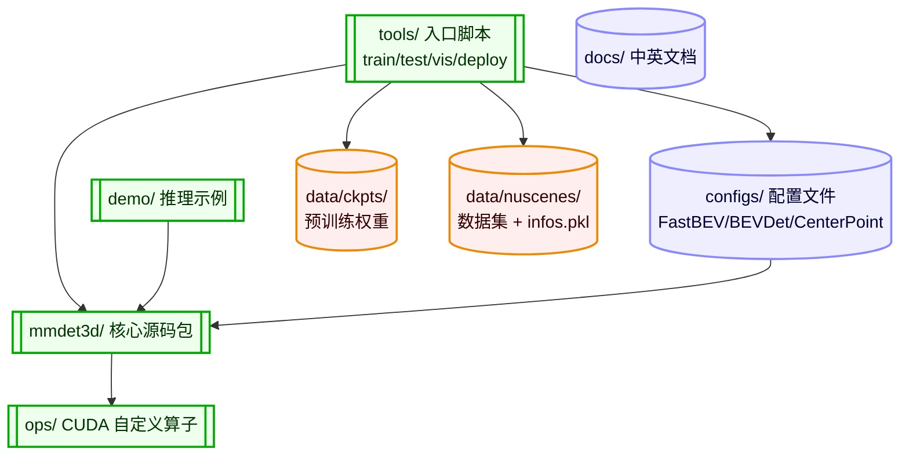

---

## 2. mmdet3d 核心包内部结构

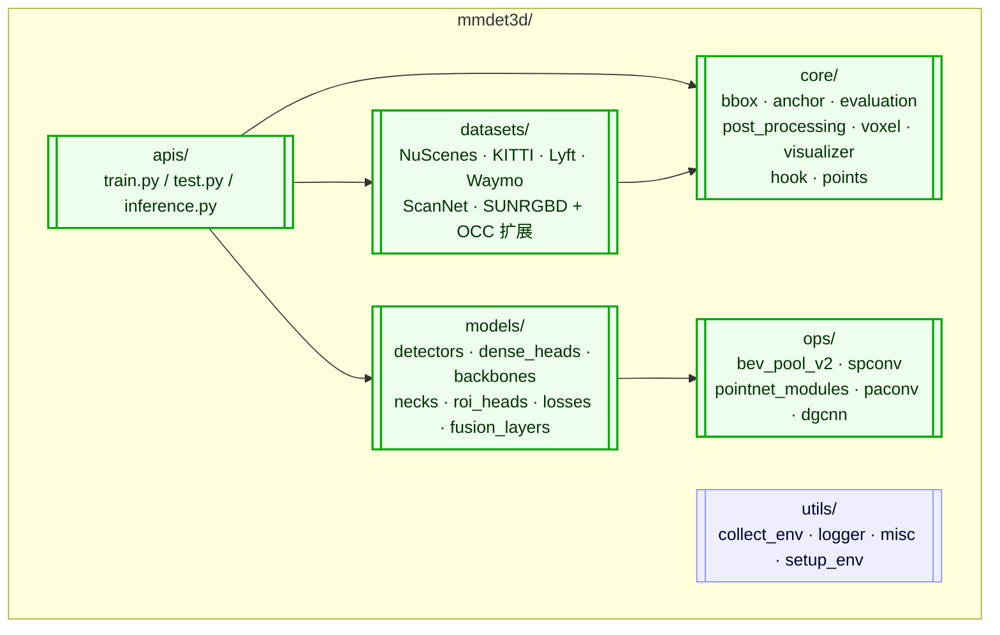

---

## 3. FastBEVOCC 网络前向流程（核心）

```mermaid
flowchart LR
    classDef tensor fill:#eef,stroke:#88f,stroke-width:2px,color:#003
    classDef layer  fill:#efe,stroke:#0a0,stroke-width:2px,color:#030
    classDef meta   fill:#fee,stroke:#e80,stroke-width:2px,color:#300
    classDef loss   fill:#ffd,stroke:#cc0,stroke-width:2px,color:#330
    classDef out    fill:#fef,stroke:#909,stroke-width:2px,color:#303

    IMG[(6 相机图像<br/>B,6,3,256,704)]:::tensor
    META[/sensor2keyego<br/>intrins · post_rots<br/>bda_aug/]:::meta
    GRID{{GridMask 可选}}:::layer
    BB[[img_backbone<br/>ResNet50<br/>out_indices=2,3]]:::layer
    NECK[[img_neck<br/>CustomFPN<br/>256ch]]:::layer
    VT[[img_view_transformer<br/>FastrayTransformer<br/>深度估计 + 体素池化]]:::layer
    BEV_RAW[(BEV 特征<br/>B,64,128,128)]:::tensor
    BEV_BB[[bev_encoder_backbone<br/>CustomResNet<br/>256→512→1024]]:::layer
    BEV_NECK[[bev_encoder_neck<br/>FPN_LSS → 256]]:::layer
    BEV[(BEV 特征<br/>B,256,128,128)]:::tensor
    HEAD_DET[[pts_bbox_head<br/>CenterHead<br/>10 类 1 task]]:::layer
    HEAD_OCC[[occ_head<br/>FastBEVOCCHead<br/>18 类 Dz=16]]:::layer
    DEPTH{{gt_depth 监督<br/>BCE 损失<br/>来自 PointToMultiViewDepth}}:::loss
    OUT_DET[/pts_bbox 输出<br/>boxes_3d · scores<br/>labels · velocity/]:::out
    OUT_OCC[/occ 输出<br/>200,200,16 uint8<br/>语义索引/]:::out

    IMG --> GRID --> BB --> NECK --> VT
    META --> VT
    VT --> BEV_RAW --> BEV_BB --> BEV_NECK --> BEV
    BEV --> HEAD_DET --> OUT_DET
    BEV --> HEAD_OCC --> OUT_OCC
    VT -. 深度监督 .-> DEPTH
```

---

## 4. 训练 / 测试数据流图

```mermaid
flowchart TB
    classDef pipe   fill:#efe,stroke:#0a0,stroke-width:2px,color:#030
    classDef data   fill:#fee,stroke:#e80,stroke-width:2px,color:#300
    classDef run    fill:#fef,stroke:#909,stroke-width:2px,color:#303
    classDef out    fill:#ffd,stroke:#cc0,stroke-width:2px,color:#330

    PKL[(bevdetv3-nuscenes_infos_train.pkl<br/>含 occ_path 字段)]:::data
    DS[[NuScenesDatasetOccpancy<br/>get_data_info 注入 occ_gt_path]]:::pipe

    subgraph PIPE["train_pipeline"]
        P1[[PrepareImageInputs<br/>6 相机图像 + 标定]]:::pipe
        P2[[LoadAnnotations<br/>gt_bboxes_3d / labels]]:::pipe
        P3[[LoadOccGTFromFile<br/>voxel_semantics<br/>mask_lidar · mask_camera<br/>200x200x16]]:::pipe
        P4[[BEVAug<br/>flip only (rot=0,scale=1)<br/>同步 occ GT]]:::pipe
        P5[[LoadPointsFromFile<br/>5 维 lidar]]:::pipe
        P6[[PointToMultiViewDepth<br/>生成 gt_depth]]:::pipe
        P7[[ObjectRangeFilter<br/>ObjectNameFilter]]:::pipe
        P8[[DefaultFormatBundle3D<br/>Collect3D]]:::pipe
        P1 --> P2 --> P3 --> P4 --> P5 --> P6 --> P7 --> P8
    end

    BATCH[(DataLoader batch)]:::data
    TRAINER[[apis/train.py<br/>MMCV EpochBasedRunner]]:::run
    TEST[[apis/test.py<br/>单/多 GPU 推理]]:::run
    CKPT_OUT[(work_dirs/<br/>epoch_*_ema.pth)]:::data
    RES[(results_occ.pkl<br/>list dict: pts_bbox + occ)]:::out
    VIS[[vis_fastbev_occ_results_3d.py<br/>png + ply + 视频]]:::run
    EVAL[[NuScenesDatasetOccpancy.evaluate<br/>NDS/mAP + occ mIoU/F-score]]:::run

    PKL --> DS --> PIPE
    PIPE --> BATCH
    BATCH --> TRAINER
    BATCH --> TEST
    TRAINER --> CKPT_OUT
    CKPT_OUT --> TEST
    TEST --> RES
    RES --> VIS
    TEST --> EVAL
```

---

## 5. OCC 分支细节（FastBEVOCCHead）

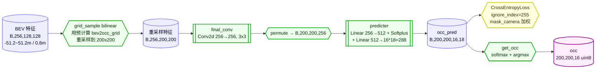

---

## 6. 工具脚本分类

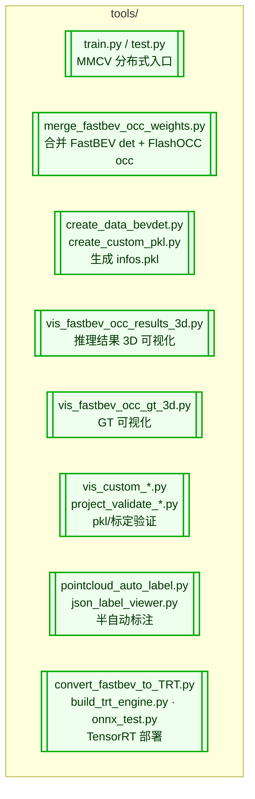

---

## 7. 配置文件分类

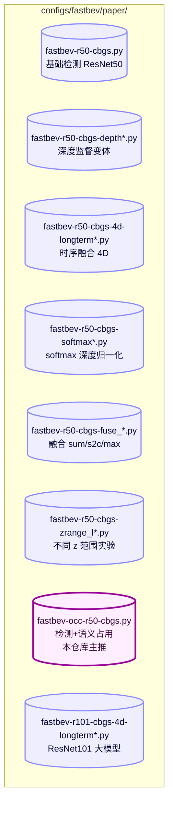

---

## 8. 核心类继承关系

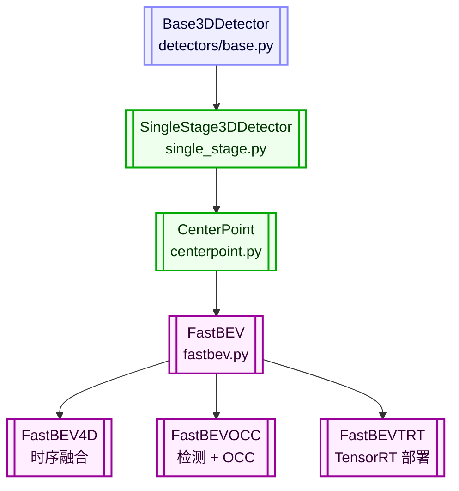

---

## 9. 数据集与评估流程

```mermaid
flowchart LR
    classDef ds    fill:#efe,stroke:#0a0,stroke-width:2px,color:#030
    classDef data  fill:#fee,stroke:#e80,stroke-width:2px,color:#300
    classDef eval  fill:#ffd,stroke:#cc0,stroke-width:2px,color:#330

    DS[[NuScenesDatasetOccpancy<br/>继承 NuScenesDataset]]:::ds
    GET_INFO{{get_data_info<br/>注入 occ_gt_path}}:::ds
    PIPE[[pipeline 输出 batch]]:::ds
    MODEL[[FastBEVOCC]]:::ds
    RES[(list dict:<br/>pts_bbox + occ)]:::data
    EVAL_DET[[NuScenesDataset.evaluate<br/>NDS / mAP (10 类)]]:::eval
    EVAL_OCC[[Metric_mIoU + Metric_FScore<br/>18 类 mIoU / F-score<br/>mask_camera 过滤]]:::eval
    GT_OCC[(labels.npz<br/>semantics + mask_lidar<br/>+ mask_camera)]:::data

    DS --> GET_INFO --> PIPE --> MODEL --> RES
    RES --> EVAL_DET
    RES --> EVAL_OCC
    GT_OCC --> EVAL_OCC
```

---

## 10. 完整推理与可视化链路

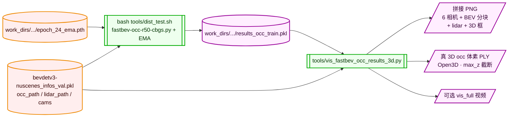

---

## 11. FastrayTransformer 视图变换器内部细节（核心）

```mermaid
flowchart TB
    classDef tensor fill:#eef,stroke:#88f,stroke-width:2px,color:#003
    classDef layer  fill:#efe,stroke:#0a0,stroke-width:2px,color:#030
    classDef meta   fill:#fee,stroke:#e80,stroke-width:2px,color:#300
    classDef loss   fill:#ffd,stroke:#cc0,stroke-width:2px,color:#330
    classDef out    fill:#fef,stroke:#909,stroke-width:2px,color:#303

    subgraph INPUT["输入"]
        IMG_FEAT[(图像特征<br/>B,6,256,16,44)]:::tensor
        META[/sensor2ego·ego2global<br/>intrins·post_rots·post_trans·bda/]:::meta
    end

    subgraph DEPTH_NET["深度 + 特征预测"]
        DN[[depth_net<br/>Conv2d 1x1<br/>256 → 60+64]]:::layer
        SPLIT{{split}}:::layer
        ACT{{depth: sigmoid/softmax<br/>60 层 · 1~60m}}:::layer
        IMG_FEAT --> DN
        DN --> SPLIT
        SPLIT --> ACT
    end

    subgraph COOR["体素→像素映射 get_fastray_input"]
        VC[(预计算 voxel_coords<br/>128·128·7 物理坐标)]:::tensor
        INV_AUG{{逆 bda 增强}}:::layer
        CE2I{{camego2img 投影<br/>inv(sensor2ego)·cam2img}}:::layer
        DEVIDE{{齐次除 z<br/>z≤0 置 inf}}:::layer
        AUG_IMG{{应用 post_rots/post_trans}}:::layer
        NORM{{坐标/stride 取整}}:::layer
        VALID{{on_img mask<br/>图像内 + 深度 1~60m}}:::layer
        DEDUP{{多相机去重<br/>后让位前}}:::layer
        VC --> INV_AUG --> CE2I --> DEVIDE --> AUG_IMG --> NORM --> VALID --> DEDUP
        META --> INV_AUG
        META --> CE2I
        META --> AUG_IMG
    end

    subgraph POOL["体素池化"]
        GATHER{{x · depth<br/>沿 c,fd 池化}}:::layer
        SCATTER{{scatter → voxel_feature}}:::layer
        RESHAPE{{reshape → B,128,128,7,64}}:::layer
        GATHER --> SCATTER --> RESHAPE
    end

    subgraph FUSE["Z 维度融合 (fuse_type)"]
        SUM{{sum 默认<br/>7 层求和}}:::layer
        S2C{{s2c<br/>Conv1x1}}:::layer
        MAX{{max<br/>取最高}}:::layer
    end

    PERM{{permute (0,3,2,1)}}:::layer
    DS{{downsample 可选}}:::layer
    OUT[(BEV 特征<br/>B,64,128,128)]:::out
    DEPTH_LOSS{{depth_loss BCE<br/>与 gt_depth}}:::loss

    SPLIT -->|feat| GATHER
    DEDUP --> GATHER
    ACT --> GATHER
    RESHAPE --> FUSE
    FUSE --> PERM --> DS --> OUT
    ACT -.-> DEPTH_LOSS
```

---

## 12. Pipeline 详细流程（训练）

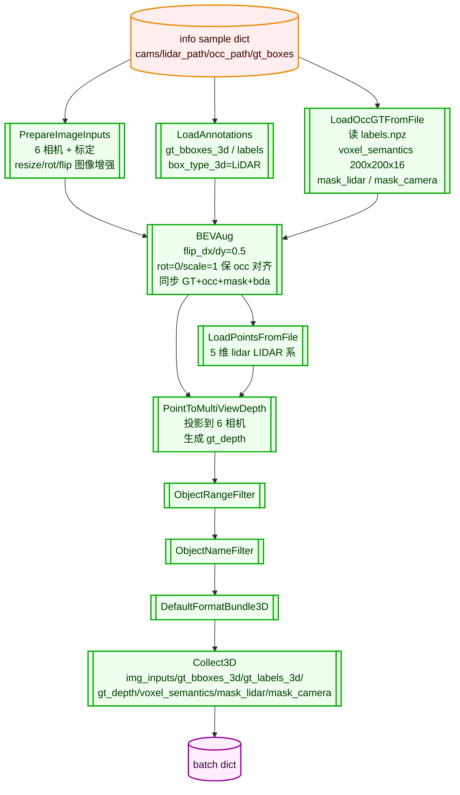

---

## 13. CenterHead 检测头细节

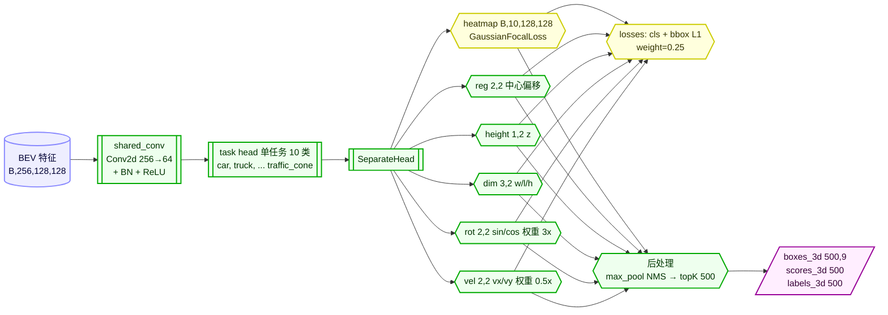

---

## 14. BEV Encoder (CustomResNet + FPN_LSS) 细节

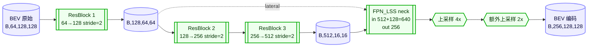

---

## 15. 全系统总览（端到端）

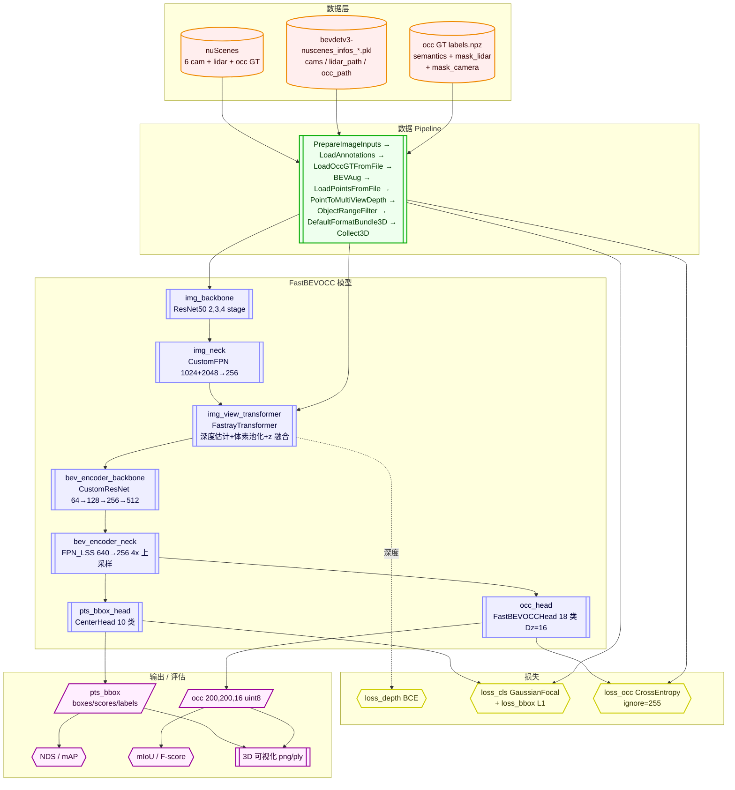

---

## 16. 关键张量形状变换（端到端）

```mermaid
flowchart LR
    classDef tensor fill:#eef,stroke:#88f,stroke-width:2px,color:#003
    classDef op    fill:#efe,stroke:#0a0,stroke-width:2px,color:#030

    A[(原始图像<br/>6,3,900,1600)]:::tensor
    B[(img_inputs<br/>B,6,3,256,704)]:::tensor
    C[(特征<br/>B,6,256,16,44 stride=16)]:::tensor
    D[(B,6,256,16,44)]:::tensor
    E[(BEV B,64,128,128,7<br/>z=7 层 -2.5~4.5m)]:::tensor
    F[(BEV B,64,128,128)]:::tensor
    G[(B,512,16,16)]:::tensor
    H[(BEV 编码<br/>B,256,128,128)]:::tensor
    I[(heatmap B,10,128,128)]:::tensor
    J[(occ_pred<br/>B,200,200,16,18)]:::tensor
    K[/pts_bbox 500 框<br/>x,y,z,w,l,h,θ,vx,vy/]:::op
    L[(occ 200x200x16 uint8)]:::tensor

    A -->|resize+crop| B
    B -->|ResNet50| C
    C -->|CustomFPN| D
    D -->|view_transformer| E
    E -->|z sum 融合| F
    F -->|CustomResNet| G
    G -->|FPN_LSS 上采样| H
    H -->|CenterHead| I
    H -->|FastBEVOCCHead| J
    I -->|NMS + topK| K
    J -->|softmax + argmax| L
```

---

## 17. 配置/权重/数据 三层依赖关系

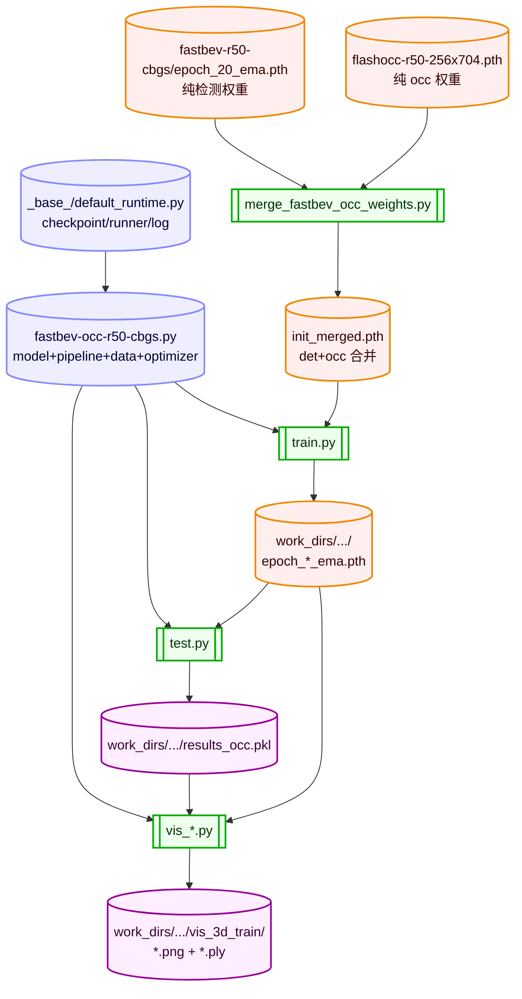

---

## 18. 检测框坐标系变换流程

```mermaid
flowchart LR
    classDef ego   fill:#fee,stroke:#e80,stroke-width:2px,color:#300
    classDef lidar fill:#eef,stroke:#88f,stroke-width:2px,color:#003
    classDef draw  fill:#fef,stroke:#909,stroke-width:2px,color:#303

    EGO_BOX[(预测框 ego 系<br/>boxes.corners)]:::ego
    LIDAR_BOX[(corners_lidar FLU<br/>N,8,3)]:::lidar
    GT_BOX[(GT 框 lidar 系<br/>LiDARInstance3DBoxes<br/>无需 +π/2 修正)]:::lidar
    BEV_DRAW[[BEV 画布<br/>y→-y 翻转<br/>(+range)/2range*size]]:::draw
    IMG_DRAW[[相机投影 lidar2img<br/>inv(sensor2lidar)+cam_intrinsic]]:::draw
    PLY_3D[[3D PLY Open3D LineSet<br/>pred 青 / GT 黄]]:::draw

    EGO_BOX -->|inv(lidar2ego)@ego| LIDAR_BOX
    LIDAR_BOX --> GT_BOX
    LIDAR_BOX --> BEV_DRAW
    LIDAR_BOX --> IMG_DRAW
    LIDAR_BOX --> PLY_3D
    GT_BOX --> BEV_DRAW
    GT_BOX --> IMG_DRAW
    GT_BOX --> PLY_3D
```

---

## 19. 多 GPU 训练 / 评估运行时

```mermaid
flowchart TB
    classDef cmd   fill:#fee,stroke:#e80,stroke-width:2px,color:#300
    classDef run   fill:#efe,stroke:#0a0,stroke-width:2px,color:#030
    classDef hook  fill:#ffd,stroke:#cc0,stroke-width:2px,color:#330

    CMD_TRAIN[/bash tools/dist_train.sh<br/>fastbev-occ-r50-cbgs.py 2/]:::cmd
    CMD_TEST[/bash tools/dist_test.sh<br/>+ epoch_24_ema.pth 2/]:::cmd
    MMCV_TRAIN[[MMCV distributed training<br/>EpochBasedRunner max_epochs=60]]:::run
    EMA_HOOK{{MEGVIIEMAHook<br/>init_updates=10560 ≈3 epoch}}:::hook
    OPT{{AdamW lr=1e-4 wd=1e-2<br/>step=[24] warmup 200 iter}}:::hook
    EVAL_HOOK{{evaluation hook<br/>interval=1 start=20<br/>NDS+mAP+occ mIoU}}:::hook
    CKPT_HOOK{{checkpoint_config<br/>interval=1 max_keep_ckpts=5}}:::hook
    DIST_TEST[[MMCV distributed test<br/>gather_results_to_rank0]]:::run
    EVAL_RUN[[NuScenesDatasetOccpancy.evaluate<br/>NDS/mAP + Metric_mIoU/FScore]]:::run

    CMD_TRAIN --> MMCV_TRAIN
    MMCV_TRAIN --> OPT
    MMCV_TRAIN --> EMA_HOOK
    MMCV_TRAIN --> EVAL_HOOK
    MMCV_TRAIN --> CKPT_HOOK
    CMD_TEST --> DIST_TEST
    DIST_TEST --> EVAL_RUN
```

---

## 20. 文件 -> 模块映射（关键文件导航）

| 模块 | 关键文件 |
|---|---|
| 检测器（FastBEV/OCC/4D/TRT） | [mmdet3d/models/detectors/fastbev.py](file:///home/server/workspace/nvidia/fastbev_py/mmdet3d/models/detectors/fastbev.py) |
| BEV/OCC 头 | [mmdet3d/models/dense_heads/bev_occ_head.py](file:///home/server/workspace/nvidia/fastbev_py/mmdet3d/models/dense_heads/bev_occ_head.py) |
| CenterPoint 检测头 | [mmdet3d/models/dense_heads/centerpoint_head.py](file:///home/server/workspace/nvidia/fastbev_py/mmdet3d/models/dense_heads/centerpoint_head.py) |
| FastrayTransformer（视图变换） | [mmdet3d/models/necks/fastray_transformer.py](file:///home/server/workspace/nvidia/fastbev_py/mmdet3d/models/necks/fastray_transformer.py) |
| BEV encoder backbone | [mmdet3d/models/backbones/resnet.py](file:///home/server/workspace/nvidia/fastbev_py/mmdet3d/models/backbones/resnet.py) (`CustomResNet`) |
| BEV encoder neck (FPN_LSS) | [mmdet3d/models/necks/lss_fpn.py](file:///home/server/workspace/nvidia/fastbev_py/mmdet3d/models/necks/lss_fpn.py) |
| 图像 FPN | [mmdet3d/models/necks/fpn.py](file:///home/server/workspace/nvidia/fastbev_py/mmdet3d/models/necks/fpn.py) (`CustomFPN`) |
| nuScenes OCC 数据集 | [mmdet3d/datasets/nuscenes_dataset_occ.py](file:///home/server/workspace/nvidia/fastbev_py/mmdet3d/datasets/nuscenes_dataset_occ.py) |
| Pipeline（加载/增强/深度） | [mmdet3d/datasets/pipelines/loading.py](file:///home/server/workspace/nvidia/fastbev_py/mmdet3d/datasets/pipelines/loading.py) |
| OCC 评估指标 | [mmdet3d/datasets/occ_metrics.py](file:///home/server/workspace/nvidia/fastbev_py/mmdet3d/datasets/occ_metrics.py) |
| 训练/测试 API | [mmdet3d/apis/train.py](file:///home/server/workspace/nvidia/fastbev_py/mmdet3d/apis/train.py), [test.py](file:///home/server/workspace/nvidia/fastbev_py/mmdet3d/apis/test.py) |
| 训练入口 | [tools/train.py](file:///home/server/workspace/nvidia/fastbev_py/tools/train.py) |
| 测试入口 | [tools/test.py](file:///home/server/workspace/nvidia/fastbev_py/tools/test.py) |
| 推理结果 3D 可视化 | [tools/vis_fastbev_occ_results_3d.py](file:///home/server/workspace/nvidia/fastbev_py/tools/vis_fastbev_occ_results_3d.py) |
| GT 3D 可视化 | [tools/vis_fastbev_occ_gt_3d.py](file:///home/server/workspace/nvidia/fastbev_py/tools/vis_fastbev_occ_gt_3d.py) |
| 权重合并 | [tools/merge_fastbev_occ_weights.py](file:///home/server/workspace/nvidia/fastbev_py/tools/merge_fastbev_occ_weights.py) |
| bev_pool 算子（CUDA） | [mmdet3d/ops/bev_pool_v2/](file:///home/server/workspace/nvidia/fastbev_py/mmdet3d/ops/bev_pool_v2/) |
| TRT 部署 | [tools/convert_fastbev_to_TRT.py](file:///home/server/workspace/nvidia/fastbev_py/tools/convert_fastbev_to_TRT.py) |

---

## 总结

共 20 张架构图，全部采用 **flowchart + subgraph + 节点形状 + classDef 着色** 风格。

**节点形状约定：**
- `[( )]` 圆柱 = 张量 / 数据
- `[[ ]]` 子程序矩形 = 网络层 / 模块
- `{{ }}` 六边形 = 操作 / 损失
- `[/ /]` 平行四边形 = 输入 / 输出 / 元信息
- `( )` 圆角 = 配置 / 资源

**颜色约定：**
- 蓝 `#eef/#88f` = 张量 / 模型层
- 绿 `#efe/#0a0` = 网络层 / 流程模块
- 橙 `#fee/#e80` = 元信息 / 数据资源
- 黄 `#ffd/#cc0` = 损失 / hook
- 紫 `#fef/#909` = 输出 / 部署产物

**查看方式：**
- VS Code 安装 `Markdown Preview Mermaid Support` 插件，`Ctrl+Shift+V` 即可渲染
- 推送到 GitHub 后浏览器自动渲染
